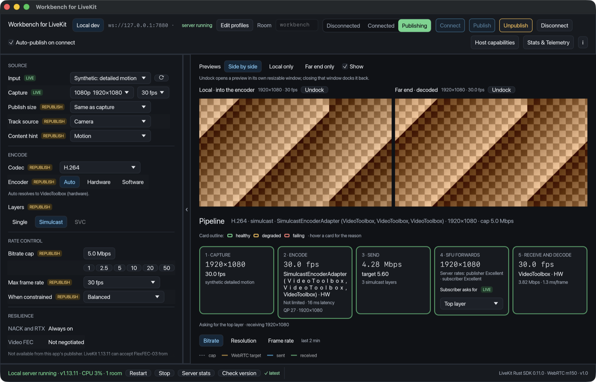
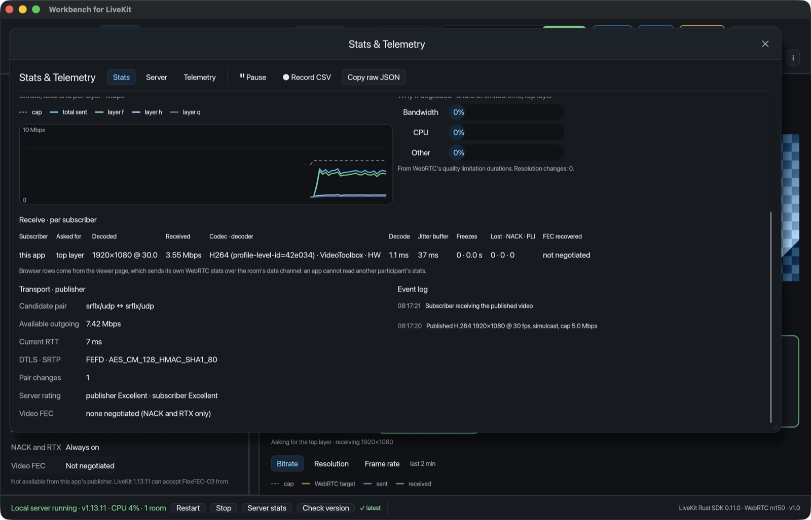
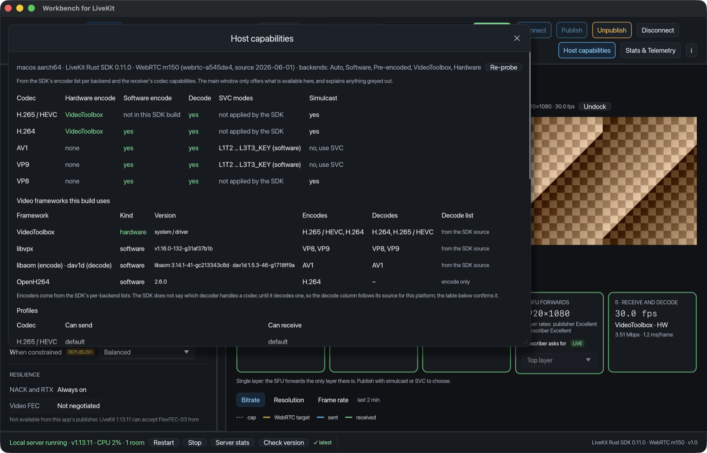
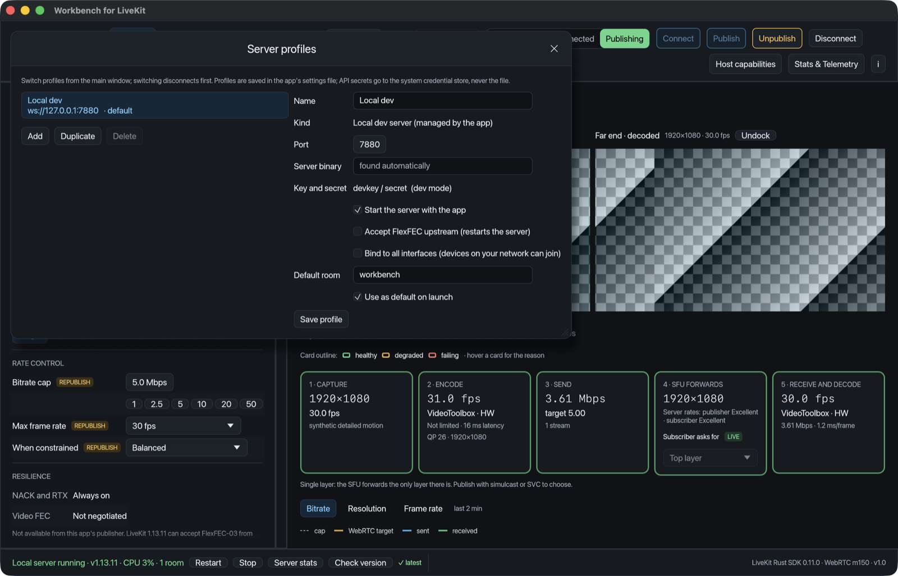
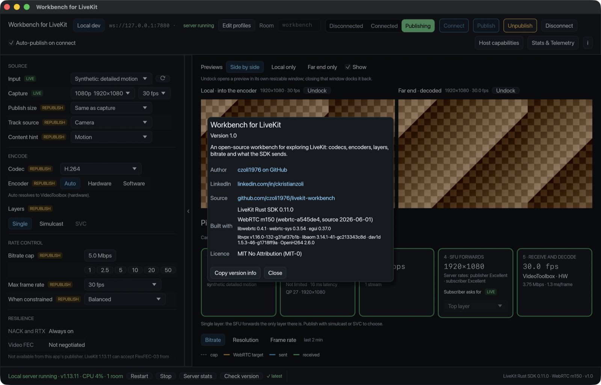

# Workbench for LiveKit

[](https://deepwiki.com/czoli1976/livekit-workbench)

A desktop app for seeing what really happens to video in [LiveKit](https://livekit.io): pick a codec, an encoder (hardware or software), simulcast or SVC, a bitrate cap, and watch every stage of the pipeline, from capture through encode, send and the SFU to the decoder at the far end, with the numbers WebRTC itself reports.



**[Install and usage guide →](docs/GUIDE.md)**

Built in Rust with the [LiveKit Rust SDK](https://github.com/livekit/rust-sdks) and [egui](https://github.com/emilk/egui). Runs on macOS, Windows and Linux.

## What it does

- **Publishes and receives in one app.** It joins a room twice, as a publisher and as a subscriber, so you see your own video come back through the SFU. Connect, publish, unpublish and disconnect are separate steps; *Auto-publish on connect* is on by default.
- **Only offers what your machine can do.** Codecs and encoders come from the SDK at start-up. Options that cannot work are greyed out with the reason, for example SVC with a hardware encoder.
- **Shows what applies live and what needs a republish.** The stock SDK keeps a published track's sender private, so changing the codec, bitrate cap or encoder republishes the track (about 1 s without video). Switching the input and choosing the subscriber's layer apply at once.
- **Pipeline cards with health outlines.** Capture, encode, send, SFU and receive each get a green, amber or red outline. Hover a card for the reason (CPU-limited encoder, still ramping, packet loss, freezes…).
- **Stats & Telemetry window.** Per-layer target vs actual resolution, frame rate and bitrate; encoder implementation; why WebRTC degraded (bandwidth, CPU); one row per subscriber, including browser viewers; transport; an event log; CSV recording; and a reference table of what the Rust SDK sends to the server.
- **Choose what the subscriber asks the SFU for.** Top layer, half or quarter size, or the size of the far-end tile; the SFU forwards the smallest simulcast or SVC layer that covers it. Browser viewers can do the same with the LiveKit JS SDK's adaptive stream.
- **Host capabilities.** Codecs per encoder and decoder framework (VideoToolbox, NVENC/NVDEC, VAAPI, libvpx, libaom, dav1d, OpenH264), the profiles WebRTC offers, what this session actually used, and hardware the build cannot use.
- **Camera or synthetic video**, shown in the local preview before you connect.
- **Audio too.** Publish a synthetic tone or a microphone, with Opus bitrate, DTX and RED. Loss, jitter, jitter buffer and concealment are shown for both directions.
- **Network impairment without admin rights.** An in-app TURN relay adds loss, delay, jitter and a rate cap to the publisher's uplink and the subscriber's downlink, live, on any OS and with any server.
- **End-to-end encryption** with a shared passphrase, including in browser viewers.
- **Remembers your settings** between launches.
- **Collapsible settings panel.** Click the handle beside it to give the video and pipeline the full width.
- **Browser viewer.** One click opens a page that joins the room, plays the video and reports its decoder stats back to the app.
- **Local dev server, managed for you.** With the *Local dev* profile the app starts `livekit-server` itself and shows its CPU, memory, rooms, traffic and log. LiveKit Cloud and self-hosted servers work through profiles; API secrets live in the system credential store (macOS Keychain, Windows Credential Manager, Secret Service on Linux).

## Quick start

The build scripts install what is missing (Rust, platform build tools, `livekit-server`), build the app and start it. Each install asks first; pass `--yes` to skip the questions.

**macOS and Linux**

```bash
git clone https://github.com/czoli1976/livekit-workbench
cd livekit-workbench
scripts/build.sh
```

**Windows** (PowerShell)

```powershell
git clone https://github.com/czoli1976/livekit-workbench
cd livekit-workbench
powershell -ExecutionPolicy Bypass -File scripts\build.ps1
```

The first build downloads a prebuilt WebRTC (about 300 MB) and takes a few minutes.

### Choosing the LiveKit SDK version

By default the scripts build with the **newest** LiveKit Rust SDK on crates.io. To pin a version:

```bash
scripts/build.sh --sdk-version 0.11.0
```

```powershell
scripts\build.ps1 -SdkVersion 0.11.0
```

Version 1.0 was tested with SDK 0.11.0. *About* shows the exact SDK version the app was built with, read from `Cargo.lock` at build time.

### What the scripts install

| | macOS | Linux | Windows |
|---|---|---|---|
| Rust | rustup | rustup | rustup |
| Build tools | Xcode command line tools | apt or dnf packages (X11/Wayland, OpenGL, V4L2), plus clang 21 for WebRTC | Visual Studio C++ build tools (winget) |
| livekit-server | Homebrew (`brew install livekit`) | GitHub release, checksum-verified, into the app's data folder | GitHub release, checksum-verified, into the app's data folder |

## Using it

1. Start the app. With the *Local dev* profile the server starts with it; the status line at the bottom shows it running.
2. Pick an input (a camera, or a synthetic source that needs no camera), a codec and an encoder.
3. Press **Connect**. With Auto-publish on, it connects and publishes at once.
4. Watch the pipeline cards and the chart. Open **Stats & Telemetry** for the details.
5. Change settings while publishing. Live settings apply at once; the others collect as pending changes until you press **Apply**.

The synthetic *detailed motion* source changes every pixel every frame, so it needs a realistic bitrate, like a camera. *Moving pattern* is cheap to encode.

### LiveKit Cloud

Add a profile under **Edit profiles** with your project URL, API key and secret, then press **Test connection**. Cloud usage is billed: a 50 Mbps test with two subscribers moves about 45 GB an hour.

### Updating the local server

At start-up the app compares the installed `livekit-server` with LiveKit's latest release on GitHub. If it is newer, the status line offers **Update**: the app disconnects, stops the server, updates it and starts it again.
- Installed by the build script on Linux or Windows (in the app's data folder): it downloads the release, checks its SHA-256 against the release's checksums and replaces the binary.
- Installed with Homebrew (macOS): it runs `brew upgrade livekit`. Homebrew can lag GitHub by a few days; the app says so if it does.
- Installed anywhere else: it tells you where it is and leaves the update to you.

### Command line

```bash
livekit-workbench --version     # app and SDK versions
livekit-workbench --caps        # what the SDK reports per encoder backend
livekit-workbench --headless --codec vp9 --encoder sw --layers L3T3_KEY --seconds 20
livekit-workbench --headless --help
```

Headless mode publishes and receives without a window, prints one line of stats per second, and exits 0 when video made the round trip. `--lifecycle` also exercises unpublish, publish, republish and a live source switch; `--ask 320x180` checks that asking for a smaller tile gets a smaller layer. `--audio tone` adds audio, and `--up 5,40` / `--down 0,0,0,1000` impair the links (`LOSS%,DELAY,JITTER,KBPS`).

## Good to know

- **Simulcast** is offered for VP8, H.264 and H.265. With VP9 and AV1, WebRTC does not send separate streams for the simulcast request this SDK makes: VP9 becomes one stream with spatial layers and AV1 a single layer. Use SVC for those codecs, as LiveKit does.
- **SVC** is offered for VP9 and AV1 with a software encoder only. The SDK applies a scalability mode only for those codecs, and its hardware AV1 encoders advertise L1T1 only.
- **On macOS the SDK uses VideoToolbox for H.264 and H.265 only**, to encode and to decode. VP8 and VP9 use libvpx, and AV1 uses libaom to encode and dav1d to decode, even on Macs whose hardware can decode AV1 (M3 and later) or VP9. Asking for a hardware encoder with those codecs still gets the software one, so the app shows them as software only. Browser viewers such as Safari may use the hardware decoders; their rows in Stats show what the browser reports. There is no software H.265 encoder in the SDK, so H.265 always uses VideoToolbox.
- **Content hint (W3C `contentHint`).** The Rust SDK has no setter for it, so the app sets the video source's screencast flag, which is exactly what WebRTC turns `contentHint` "detail" and "text" into ("motion" clears it); nothing else in WebRTC reads the hint once a degradation preference is set, and the SDK always sets one. With Detail / text, WebRTC turns *Balanced* into *keep resolution* (it drops frames instead of lowering the size), raises a low bitrate cap to 1.2 Mbps and labels frames as screen content. LiveKit's WebRTC also caps VideoToolbox's QP at 39 and uses H.264 Baseline at an automatic level, and OpenH264 switches to its screen-content mode. NVENC, VAAPI and Jetson do nothing extra with it. It does not change which encoder is chosen.
- **Video FEC is not used by this app's publisher; recovery is NACK and RTX.** LiveKit 1.13.11 can accept FlexFEC-03 from publishers (`rtc.flexfec.upstream_enabled`, the Local dev profile's *Accept FlexFEC upstream*), but WebRTC only offers FlexFEC with its `WebRTC-FlexFEC-03` field trials, and the Rust SDK compiles in a fixed set without them. WebRTC also offers ULPFEC with RED, and the LiveKit server's answer leaves them out. To test it, **Publish from Chrome** (under the browser invite) starts a separate Chrome with those field trials, on its own profile, and publishes a synthetic video with the panel's settings; the app receives it, and shows whether FlexFEC was negotiated and what the server recovered. In LiveKit 1.13.11 FlexFEC is publisher → SFU only: the server decodes it to repair the upstream and forwards plain media; subscribers rely on NACK and RTX. Downstream FlexFEC (SFU → subscriber, per-track protection modes) and FlexFEC in the Rust SDK are open pull requests as of November 2026 (livekit/livekit#5195, livekit/protocol#1987, livekit/rust-sdks#1424 and #1668). Chrome sends FEC in proportion to the loss it sees, so on a loss-free link it negotiates FlexFEC but sends little or none. Stats show which FEC, if any, was negotiated.
- **Bitrate ramps up.** WebRTC starts a camera track at no more than 1 Mbps and raises its estimate over about a minute. Publishing as *Screen share* starts near the cap.
- **Disconnect returns at once.** On machines with network security software, closing WebRTC's sockets can take several seconds; the app finishes that in the background.

## Hardware video per platform

What the app offers comes from the SDK at start-up (`livekit-workbench --caps` prints it), so it adapts to each machine. What the LiveKit Rust SDK (0.11.0) can use:

| | Hardware encode | Hardware decode | Software encode | Software decode |
|---|---|---|---|---|
| macOS | VideoToolbox: H.264, H.265 | VideoToolbox: H.264, H.265 | VP8, VP9, AV1, H.264 (OpenH264) | VP8, VP9, AV1 |
| Linux, NVIDIA GPU | NVENC: H.264, H.265, AV1 (AV1 on GPUs that have it) | NVDEC: H.264, H.265 | same | VP8, VP9, AV1 |
| Linux, Intel/AMD (x86) | VAAPI: H.264 | none | same | VP8, VP9, AV1 |
| Linux, NVIDIA Jetson | Jetson: H.264, H.265, AV1 | none | same | VP8, VP9, AV1 |
| Windows | none in this SDK build | none | VP8, VP9, AV1, H.264 (OpenH264) | VP8, VP9, AV1 |

Things that follow from this:

- **Linux hardware support is decided when you build.** VAAPI is compiled in only if `libva-dev` is installed (the build script installs it), NVENC/NVDEC only if the CUDA toolkit is found at `/usr/local/cuda` or `$CUDA_HOME`, and Jetson only if the Jetson Multimedia API is installed. Each is then switched on at run time if the driver and GPU are there. Install the CUDA toolkit before building to get NVENC.
- **Windows has no hardware encoding in this SDK**, and **H.265 cannot be published on Windows** or on Linux without NVENC or Jetson: there is no software H.265 encoder.
- **H.264 and H.265 need a hardware decoder to be received by the app** on Windows and Linux: the SDK's desktop builds have no software H.264 or H.265 decoder. Without one, the app publishes fine but its own far-end preview stays empty; it says so under the codec, and a browser viewer receives the stream.

These are read from the SDK's source and checked on macOS; Windows and Linux are covered by CI builds, not yet by hands-on runs on those machines.

## Building by hand

```bash
cargo build --release
cargo test
```

On macOS, `scripts/make-app.sh` wraps the binary in `dist/Workbench for LiveKit.app`, which macOS needs to ask for camera access.

## Screenshots

| Stats & Telemetry | Host capabilities |
|---|---|
|  |  |
| **Server profiles** | **About** |
|  |  |

## Licence

[MIT No Attribution (MIT-0)](LICENSE): use, copy, modify and sell it, commercially or not, with no conditions and no attribution required. A built app also contains third-party software under its own permissive licences (LiveKit SDK, WebRTC, egui); see [NOTICE](NOTICE).

## Author

[czoli1976](https://github.com/czoli1976) · [LinkedIn](https://www.linkedin.com/in/ckristianzoli)

Workbench for LiveKit is an independent project and is not affiliated with LiveKit, Inc.
