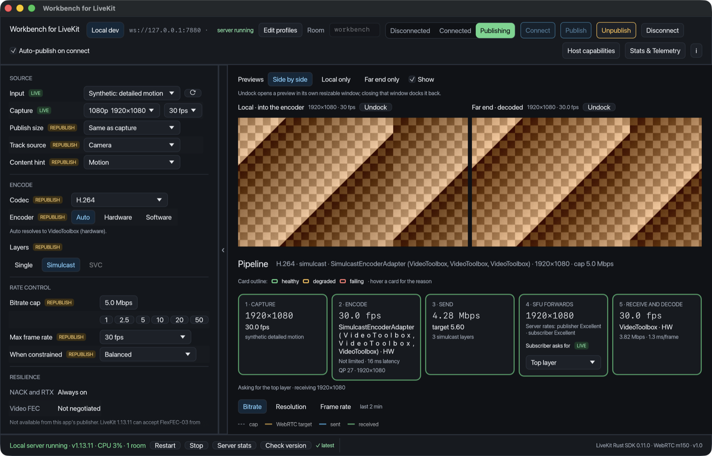
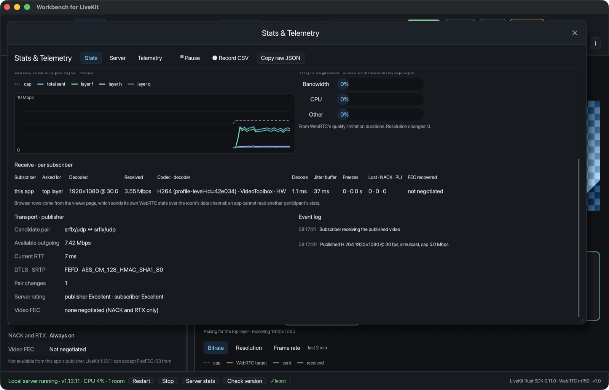
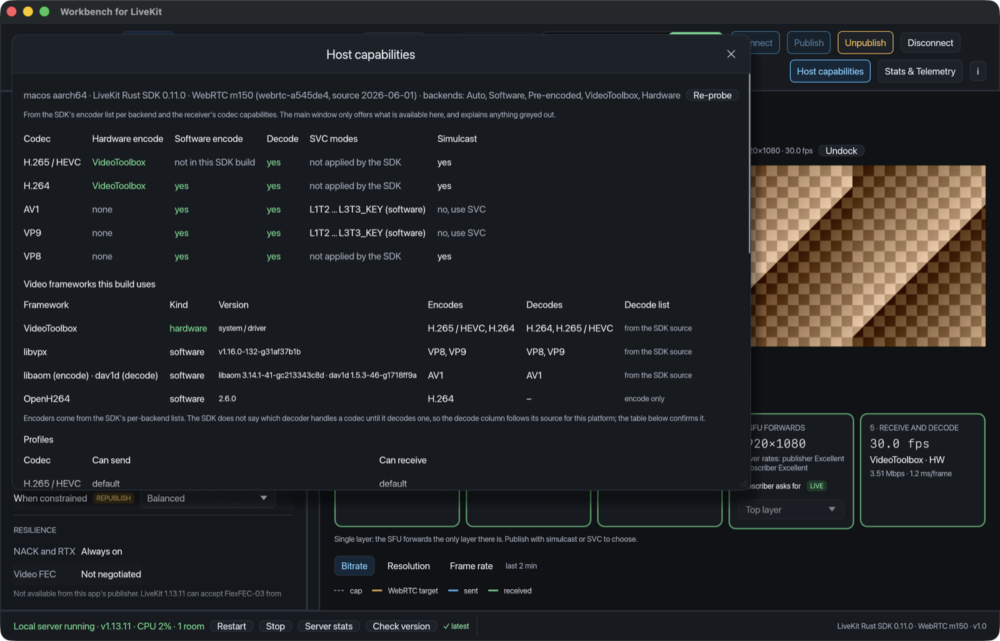
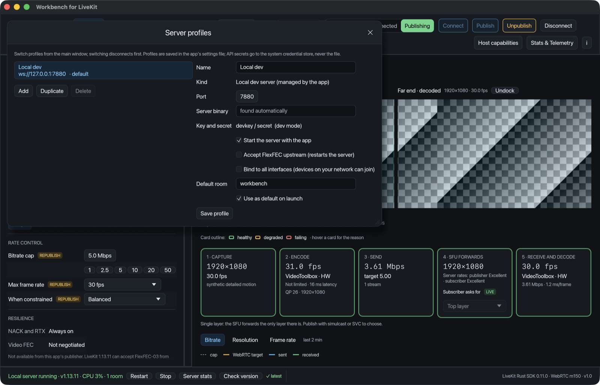

# Workbench for LiveKit: install and use

- [Install](#install)
- [First run](#first-run)
- [The main window](#the-main-window)
- [Publish settings](#publish-settings)
- [Pipeline cards](#pipeline-cards)
- [What the subscriber asks the SFU for](#what-the-subscriber-asks-the-sfu-for)
- [Stats & Telemetry](#stats--telemetry)
- [Host capabilities](#host-capabilities)
- [Server profiles and LiveKit Cloud](#server-profiles-and-livekit-cloud)
- [The local server](#the-local-server)
- [Browser viewer](#browser-viewer)
- [Publish from Chrome with FlexFEC](#publish-from-chrome-with-flexfec)
- [Command line and headless tests](#command-line-and-headless-tests)
- [Troubleshooting](#troubleshooting)

## Install

You need about 6 GB of free disk space for the first build: the LiveKit SDK downloads a prebuilt WebRTC and compiles it into the app.

### macOS

```bash
git clone https://github.com/czoli1976/livekit-workbench
cd livekit-workbench
scripts/build.sh
```

The script checks for the Xcode command line tools, Rust and `livekit-server` (through Homebrew), asks before installing anything that is missing, builds the app, wraps it in `dist/Workbench for LiveKit.app` and opens it. Start it from that app bundle afterwards: macOS asks for camera access only for a bundled app.

### Linux

```bash
git clone https://github.com/czoli1976/livekit-workbench
cd livekit-workbench
scripts/build.sh
```

On Debian and Ubuntu the script installs the build packages with apt (on Fedora with dnf), Rust with rustup, and `livekit-server` from LiveKit's GitHub release into the app's data folder, checking the download's SHA-256. For hardware video:

- **NVIDIA:** install the CUDA toolkit before building, or set `CUDA_HOME`. NVENC and NVDEC are compiled in only when it is found.
- **Intel or AMD:** `libva-dev` (installed by the script) plus your GPU's VAAPI driver (`intel-media-va-driver` or `mesa-va-drivers`).

### Windows

```powershell
git clone https://github.com/czoli1976/livekit-workbench
cd livekit-workbench
powershell -ExecutionPolicy Bypass -File scripts\build.ps1
```

The script installs the Visual Studio C++ build tools with winget, Rust with rustup and `livekit-server` from LiveKit's GitHub release, then builds and starts the app. This SDK build has no hardware video on Windows.

### Options

| | macOS / Linux | Windows |
|---|---|---|
| Pin the LiveKit Rust SDK version (default: newest) | `--sdk-version 0.11.0` | `-SdkVersion 0.11.0` |
| Install without asking | `--yes` | `-Yes` |
| Build only, do not start | `--no-run` | `-NoRun` |
| Skip livekit-server (LiveKit Cloud only) | `--no-server` | `-NoServer` |

The app was tested with SDK 0.11.0; *About* shows the exact versions it was built with.

## First run

1. Start the app. With the **Local dev** profile it starts `livekit-server` itself; the status line at the bottom shows *Local server running*, its version, and *✓ latest* once it has checked LiveKit's releases.
2. The input starts on your camera (the first one the system lists; on macOS allow camera access when asked). Without a camera it starts on **Synthetic: detailed motion**, which needs none. Press **Connect**. With *Auto-publish on connect* on, the app connects, publishes and receives its own video back through the server.
3. The previews show what goes into the encoder and what comes back decoded; the five cards below follow each stage.



## The main window

- **Top bar:** the server profile, *Edit profiles*, the room name, the connection state (Disconnected, Connected, Publishing) and the actions: Connect, Publish, Unpublish, Disconnect. *Host capabilities*, *Stats & Telemetry* and the *i* (About) button are on the right.
- **Left panel:** the publish settings. The handle (‹ ›) beside it hides and shows it, to give the video more room.
- **Centre:** the previews, the pipeline cards and a chart of the last two minutes.
- **Status line:** the local server's state, Restart / Stop, *Server stats*, *Check version* and any update offer.

Previews can show side by side, local only or far end only. **Undock** puts a preview in its own resizable window; closing that window docks it back. In full-screen mode undocked previews and the Stats window open as panels inside the main window.

## Publish settings

Every setting carries a badge:

- **LIVE** applies at once: the input, the capture format, and what the subscriber asks for.
- **REPUBLISH** needs the track published again (about 1 s without video): publish size, track source, content hint, codec, encoder, layers, bitrate cap, max frame rate, *When constrained*. The stock SDK keeps a published track's sender private, so these cannot change in place.

While publishing, republish changes collect in a banner at the top of the panel; press **Apply** to republish or **Revert** to go back.

What the settings do:

- **Input:** a camera, *Synthetic: detailed motion* (changes every pixel, needs a realistic bitrate) or *Synthetic: moving pattern* (cheap to encode). The input shows in the local preview as soon as you pick it, before you connect. If an input fails while publishing, the track stays published: pick another input. Screen sharing is hidden for now; the headless mode can still test it with `--source screen`.
- **Publish size:** frames are scaled to this before the encoder. Pick a fixed size to switch inputs live.
- **Track source:** *Screen share* makes the SDK start WebRTC's bitrate estimate near the cap instead of at most 1 Mbps.
- **Content hint:** *Motion* or *Detail / text*, the equivalent of the W3C `contentHint`. Detail / text turns *Balanced* into *keep resolution*, and changes encoder settings for VideoToolbox and OpenH264; hover it for the details.
- **Codec and encoder:** only what this machine can do is enabled; hover a greyed-out option for the reason. *Auto* says which encoder it resolves to.
- **Layers:** *Single*, *Simulcast* (VP8, H.264, H.265) or *SVC* (VP9 and AV1 with a software encoder) with a scalability mode such as L3T3_KEY.
- **Rate control:** the bitrate cap, the max frame rate, and *When constrained* (keep resolution, keep frame rate, balanced, or keep both).
- **Audio** (REPUBLISH): *Off*, *Synthetic tone* or a microphone.
  - *Synthetic tone* is a 440 Hz beep, 0.6 s on and 0.4 s off. It needs no microphone and plays nothing.
  - With a microphone, the app plays the audio it receives, about a round trip late. Use headphones, or keep echo cancellation (AEC) on.
  - Opus settings: the bitrate cap (a slider from 6 to 510 kbps; in mono WebRTC's Opus stops rising at about 200 kbps), *DTX* (almost nothing is sent during silence) and *RED* (each packet also carries the previous frame, which roughly doubles the bitrate).
  - Microphones also have AEC, AGC and noise suppression switches.
  - Audio stats for both directions appear under the pipeline and in Stats: bitrate, loss, jitter, jitter buffer, and the share of audio the receiver had to invent ("concealed").
- **Network impairment** (RECONNECT, then live): see [Network impairment](#network-impairment).
- **Security** (RECONNECT): *End-to-end encryption* with a shared passphrase (AES-GCM frame encryption). The server forwards media it cannot read. Browser viewers opened from the app get the same key in their link. The pipeline shows whether the subscriber decrypts.

The app remembers these settings and the view choices between launches. They are saved in `settings.json`, in the app's configuration folder, beside the server profiles. The E2EE passphrase is saved there in plain text, so use a test passphrase.

## Network impairment

*Route through impairment relay* sends both of the app's connections through a TURN relay running inside the app. The relay drops, delays and rate-limits packets. It needs no admin rights and changes nothing on the system. It works the same on macOS, Linux and Windows, and with any server, LiveKit Cloud included.

- **Publisher uplink** shapes what the publisher sends to the server.
- **Subscriber downlink** shapes what the server sends to the subscriber.

Impairment starts once both connections are up: delay during WebRTC's connection setup sometimes stopped the publisher connecting. Each direction has four settings, and you can change them live while connected:

- **Loss:** random, in percent.
- **Delay:** fixed delay, in ms.
- **Jitter:** extra random delay up to this many ms. Packets stay in order.
- **Rate:** a bottleneck in kbps. Packets queue behind it and are dropped once more than 300 ms of queue builds up.

Feedback in the other direction (RTCP, NACK) is not impaired. While a direction is impaired, a line under the pipeline shows what passed and what was dropped.

Things to try:
- Uplink loss: watch the encoder step down.
- A downlink rate cap with simulcast: the SFU switches to a lower layer.
- A downlink rate cap with a single layer: the SFU has nothing lower to send, so video stalls.
- RED on and off under audio loss: compare the concealed share.

## Pipeline cards

Capture, Encode, Send, SFU forwards, and Receive and decode. Each card's outline shows its health: green healthy, amber degraded, red failing; hover a card for the reason. Examples: the encoder delivering fewer frames than captured, WebRTC lowering the resolution because of bandwidth or CPU, retransmissions above 5%, the SFU forwarding a smaller layer than asked for, packet loss, or freezes.

For hardware encoders the Encode card shows *ms latency*: hardware encoders work on several frames at once, so that number is not load.

The chart switches between bitrate (cap, WebRTC's target, sent, received), resolution and frame rate.

## What the subscriber asks the SFU for

The **SFU forwards** card has one control, *Subscriber asks for*:

- **Top layer:** the full size.
- **Fit the far-end tile:** the size of the far-end preview in physical pixels, docked or undocked, sent at most every 5 s and only when it changes.
- **Half size** / **Quarter size.**

The SFU forwards the smallest simulcast or SVC layer that covers the request. With a single layer there is nothing to choose, so the control is disabled. The line under the cards shows what was asked and what arrives. The card also shows the server's own rating of the publisher's and subscriber's connections.

## Stats & Telemetry



- **Stats:** totals, one row per sent RTP stream (target vs actual resolution, frame rate and bitrate, encoder, QP, why WebRTC degraded), a per-layer bitrate chart, one row per receiver (this app and browser viewers), transport, and an event log. **Pause**, **Record CSV** (one row per second, saved in Downloads) and **Copy raw JSON**.
- **Server** (Local dev): the server's CPU, memory, rooms, participants, traffic, warnings, FlexFEC counters and log.
- **Telemetry:** what the Rust SDK sends to the server, and what it does not, read from the SDK's source.

## Host capabilities



What this machine and SDK build can do: per codec, hardware and software encoders, decoding, SVC and simulcast; the video frameworks in use with their versions (VideoToolbox, NVENC/NVDEC, VAAPI, libvpx, libaom, dav1d, OpenH264); the profiles WebRTC can send and receive; the encoder and decoder actually used for each codec this session; and notes about hardware the build cannot use. `livekit-workbench --caps` prints the raw probe.

## Server profiles and LiveKit Cloud



**Edit profiles** manages where the app connects:

- **Local dev:** the app starts and owns `livekit-server` in dev mode (key `devkey`, secret `secret`). Options: port, binary path, start with the app, *Accept FlexFEC upstream*, and bind to all interfaces so other devices on your network can join.
- **LiveKit Cloud or self-hosted:** press **Add**, enter the URL (`wss://…`), API key and API secret, and **Test connection**. The secret is stored in the system credential store (macOS Keychain, Windows Credential Manager, Secret Service on Linux), never in the settings file.

Switching profile disconnects first. LiveKit Cloud usage is billed: a 50 Mbps test with two subscribers moves about 45 GB an hour.

## The local server

At start-up, and when you press **Check version**, the app compares the installed `livekit-server` with LiveKit's latest GitHub release. If a newer one exists, the status line offers **Update**, which disconnects, stops the server, updates it and starts it again:

- Installed by the build script (Linux, Windows): the release is downloaded, checked against LiveKit's SHA-256 checksums and swapped in.
- Installed with Homebrew (macOS): `brew upgrade livekit`. Homebrew can lag GitHub by a few days; the app says so.
- Installed elsewhere: the app shows where, and leaves the update to you.

If the app finds a server left running by an earlier run that crashed or was force-quit, it stops it and starts a fresh one.

## Browser viewer

Under the previews, **Open in Chrome**, **Default browser** or **Copy link** opens a page that joins the room, plays the video, and reports its decoder, size, frame rate, bitrate, loss and freezes back to the app, where it appears as a row in Stats. The page is served by the app on 127.0.0.1 only. *Browser asks optimal resolution* makes the next viewer use the LiveKit JS SDK's adaptive stream, so it asks the SFU for a layer that fits its video element.

## Publish from Chrome with FlexFEC

This app's publisher cannot offer FlexFEC: the Rust SDK compiles in a fixed set of WebRTC field trials without it. To test the server's upstream FlexFEC (LiveKit 1.13.11 and later), **Publish from Chrome** starts a separate Chrome, on its own profile, with WebRTC's FlexFEC-03 field trials, and publishes a synthetic video with the panel's codec, size, frame rate, bitrate cap and layers. Unpublish first: the app then receives the Chrome stream.

The app shows whether FlexFEC was negotiated, Chrome's encoder and frame rate, media and on-the-wire bitrate, RTX, and the server's FEC counters. Chrome sends FEC in proportion to the loss it sees, so test on a lossy link (macOS Network Link Conditioner, Linux `tc netem`) to see repairs. The app's own impairment relay does not shape Chrome's connection. On the Local dev profile, *Turn it on* enables FlexFEC on the server if it is off.

In LiveKit 1.13.11, FlexFEC is publisher → SFU only; subscribers recover with NACK and RTX.

## Command line and headless tests

```bash
livekit-workbench --version     # app, SDK, WebRTC and codec library versions
livekit-workbench --caps        # what the SDK reports per encoder backend
livekit-workbench --headless --codec vp9 --encoder sw --layers L3T3_KEY --seconds 20
livekit-workbench --headless --help
```

Headless mode publishes and receives without a window, prints one line of stats per second and exits 0 when video made the round trip. It connects to `LIVEKIT_URL` (default `ws://127.0.0.1:7880`) with `LIVEKIT_API_KEY` and `LIVEKIT_API_SECRET` (default the dev key). Useful options:

- `--lifecycle`: unpublish, publish, republish, then a live source switch.
- `--ask 320x180`: a smaller layer arrives.
- `--detail-hint`
- `--chrome-pub`: Chrome publisher with FlexFEC.
- `--e2ee PASSPHRASE`
- `--audio tone`: the run also fails if audio does not arrive. Add `--audio-kbps 24`, `--no-dtx`, `--no-red`, `--no-aec`, `--no-ns` or `--no-agc` to change the Opus settings or WebRTC's processing.
- `--up 5,40,10` and `--down 0,0,0,1000`: impairment as `LOSS%,DELAY,JITTER,KBPS`; trailing fields are optional.

## Troubleshooting

- **"Could not connect … Connection refused":** the local server is not running. Check the status line; press *Start server* or *Restart*. The server log is in Stats & Telemetry › Server.
- **livekit-server not found:** run the build script again, or set its path in Edit profiles › Local dev › Server binary.
- **No camera in the list (macOS):** start the app from `dist/Workbench for LiveKit.app` and allow camera access when asked, or in System Settings › Privacy & Security › Camera. The synthetic sources need no camera.
- **The far-end preview stays empty with H.264 or H.265 (Windows, Linux without NVIDIA):** the SDK has no software decoder for those codecs there. The app says so under the codec; a browser viewer can receive the stream.
- **Bitrate stays well below the cap:** WebRTC ramps up over about a minute. *Track source: Screen share* starts near the cap.
- **Disconnect takes a moment to finish:** on machines with network security software, closing WebRTC's sockets can take seconds; the app finishes that in the background.
